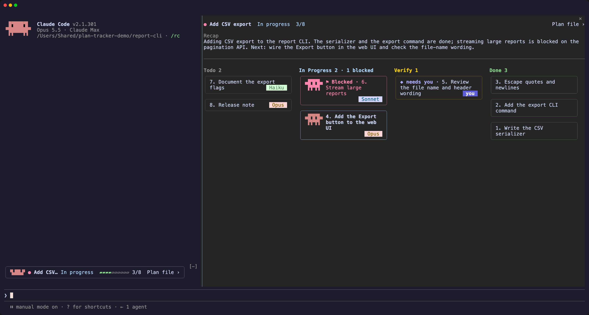
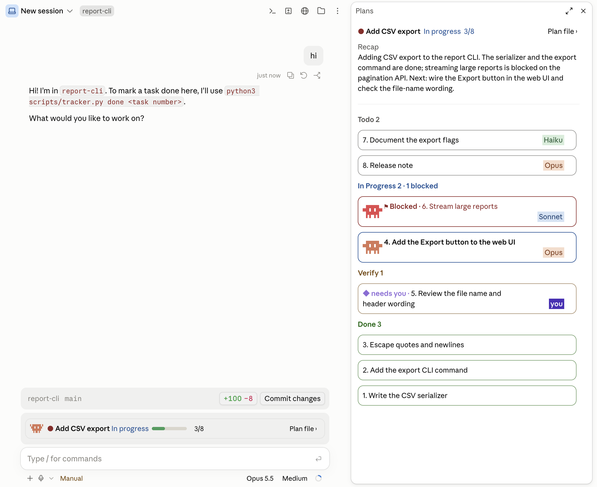
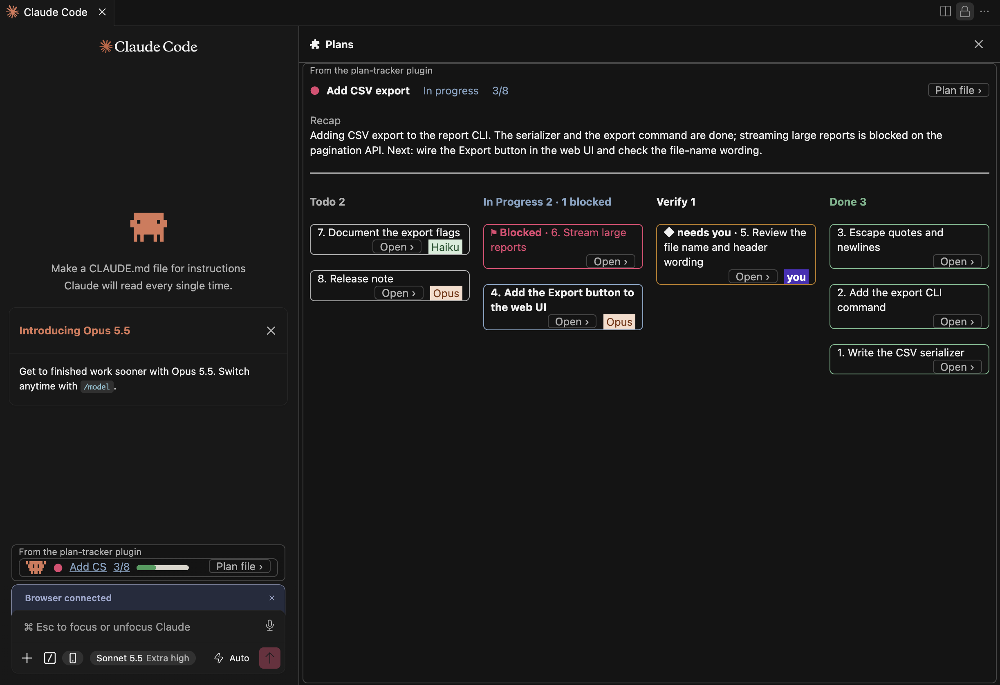
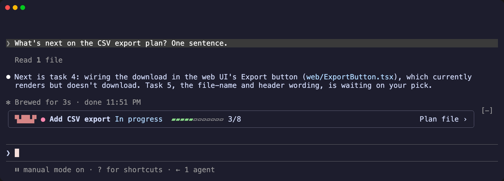
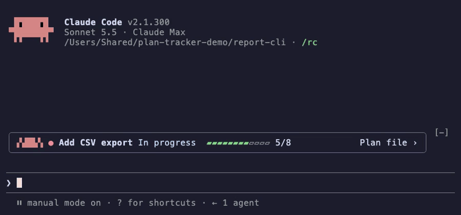
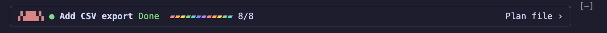
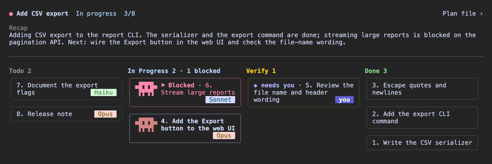
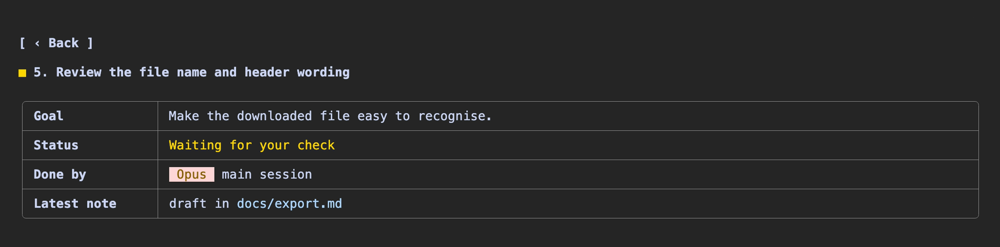

<sub>The board on the cover is a demo plan: adding CSV export to a report CLI, 3 of 8 tasks done.</sub>

<h3 align="center">
  <a href="#get-started">Get started</a> |
  <a href="#where-it-runs">Where it runs</a> |
  <a href="#what-you-get">What you get</a> |
  <a href="#how-it-works">How it works</a> |
  <a href="#compared">Compared</a> |
  <a href="#try-it">Try it</a> |
  <a href="#limits">Limits</a> |
  <a href="#reference">Reference</a>
</h3>

# plan-tracker

Claude Code mod that puts your plan on one live board: every task, who's on it, and what waits on you.

## Get started

Install plan-tracker and [plan-orchestrator](https://github.com/lijingwu2026/claude-code-plan-orchestrator), the separate plugin that writes your plan's tasks to `PROGRESS.md`:

```
/plugin marketplace add lijingwu2026/claude-code-plan-orchestrator
/plugin install plan-orchestrator@plan-orchestrator
/plugin marketplace add lijingwu2026/claude-code-plan-tracker
/plugin install plan-tracker@plan-tracker
```

| To | Do |
|---|---|
| See your plan | Approve a plan in plan mode. The band appears above your prompt, in every session of that project. |
| Open the board | Press the bar, or type `/plan-tracker`. |
| Pick a plan | `/plan-tracker` lists your open plans, newest first, with a search field. Typing also finds done and canceled plans. This needs a board command that lists several plans. A plain `PROGRESS.md` has one plan, so it opens its board. |
| Use your own `PROGRESS.md` | Copy the table under [Try it](#try-it). plan-orchestrator is not needed. |

## Where it runs

| Place | Status | Tested on | Screenshot |
|---|---|---|---|
| Terminal (macOS) | Tested | Claude Code 2.1.301 | [terminal](docs/platform-terminal.png) |
| Claude Desktop app (macOS) | Tested | Desktop 2.31226.1, which runs Claude Code 2.1.295 | [Desktop](docs/platform-desktop.png) |
| VS Code extension | Tested in Cursor | Claude Code extension 2.1.300; VS Code itself is not tested | [Cursor](docs/platform-vscode.png) |
| `claude -p`, Claude mobile, claude.ai web | Not tested | | |



<sub>Terminal: the band above the prompt, and the board opened from it.</sub>



<sub>Claude Desktop: the same band and board in a Code session.</sub>



<sub>VS Code extension, in Cursor: the band's name and progress are links; each card opens with Open ›.</sub>

## What you get

### Plan band






<sub>Once the last open task goes Done, the bar turns to a rainbow until your next prompt.</sub>

- Above your prompt: the state word (`In progress`, `Waiting for you`, `Idle` or `Done`), done out of total (`3/8`) and a bar. The plan reads `In progress` while Claude is working on it, even when no task is marked In Progress, and `Waiting for you` when the only tasks left wait on your check.
- **A task is done** → a pop-up `✅ <task> · N left` and, in the terminal, a chime.
- **You come back, or start a new session** → the band shows the file's state; the board has Claude's last recap.

### Board



- **Claude adds a task** → a card for it appears.
- **A task is blocked** → its card sits red at the top of In Progress; open its page and the latest note says why.
- **You want to know who runs what** → each open card is tagged with who has it: `Opus`, `Sonnet`, `Haiku` or `you` (in Verify, who checks it). A Done task's page says who did it and who checked it.

### Task page



- **A task needs your review** → its card says `◆ needs you`; open its page for the goal and the latest note.

## How it works

The route skill in plan-orchestrator writes your plan's tasks to `PROGRESS.md` and updates them as they run. plan-tracker reads that file and never writes it.


## Compared

Use plan-tracker alongside Claude Code's own views; each shows something different.

| Claude Code's | It shows | plan-tracker adds |
|---|---|---|
| Agent map (Desktop, VS Code) | This session's subagents, each with its status, time and tokens | The plan's tasks across sessions: who has each one and what waits on you |
| Background tasks (`/tasks`) | Shells and subagents running in this session, cleared when Claude Code exits | Which tasks are running, blocked or done, kept in a file after the session ends |

## Try it

Save this as `PROGRESS.md` in your project root. The band appears within a few seconds, the board shows a card in Done, In Progress and Verify, and task 3 says `◆ needs you`.

```markdown
# Add CSV export

| task | status | executor | check | evidence |
|---|---|---|---|---|
| 1. Write the serializer | Done | subagent · Sonnet | script | 12 tests pass |
| 2. Add the export command | In Progress | main session · Opus | script | |
| 3. Review the file name wording | Needs Verification | main session · Opus | you | draft ready |
```

Change a status in the file and the board follows.

## Limits

- Read-only for your board: it never writes `PROGRESS.md`.
- Polls the file about every 1.5 s; it does not use file-system events.
- Shows the first table in the file with `task` and `status` columns, as one plan.
- Every open session on the same project shows the pop-up and plays the chime when a task goes Done.
- Tested on macOS only; see [Where it runs](#where-it-runs) for versions.
- In the VS Code extension, file paths in notes are plain text; they do not open when pressed.
- Claude Code mods are an early-access feature.

## Troubleshooting

- **No band.** Run `/plan-tracker`: the board says what is wrong with the file. It needs a table with `task` and `status` columns.
- **`/plan-tracker` is not found.** Run `claude plugin list`: `plan-tracker@plan-tracker` must be enabled. If you already have a `/plan-tracker` command, yours is kept; press the bar to open the board.
- **Nothing changed after install.** Restart Claude Code. `claude plugin update` ends with "Restart to apply changes".

## Reference

[docs/reference.md](docs/reference.md): lanes, plan and card states, the board file and its columns, settings, the board command's JSON, and what plan-orchestrator fills.

## License

MIT
