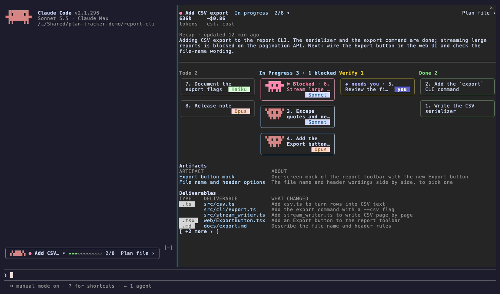

# plan-tracker

A live board of your plan's steps in Claude Code: which are done, which are running and on which model, and which are waiting on you.



*Shown with a board command that also supplies last-updated time, tokens and cost, and several plans (the `▾` after the plan name). From a plain `PROGRESS.md` you get the lanes, cards, Artifacts and Deliverables (with those columns), without the figures and with one plan.*

plan-tracker draws the `PROGRESS.md` board that [plan-orchestrator](https://github.com/lijingwu2026/claude-code-plan-orchestrator)'s route skill keeps (or any `PROGRESS.md` with a `task | status` table) as a band above the prompt and a pane of lanes, in the terminal and the Claude Desktop app.

- **How far along:** done / total and a progress bar for the plan, a card per step.
- **How it's being run:** who runs each step and on which model, from the board's `executor` column.
- **What needs you:** steps waiting on your check are marked `◆ needs you`.

## Why

Claude Code's todo list shows a session's steps. plan-tracker shows the approved plan's steps from a file on disk: who runs each one and on which model, which wait on your check, and what each one produced.

## What you see

- **Band** above the prompt: the plan's name, its state (`In progress` while a step is In Progress or Verifying, `Done` once every step is Done or Canceled, otherwise `Idle`), a progress bar and done/total. Press the bar to open the board.
- **Board:** four lanes, Todo, In Progress, Verify and Done. A Blocked card sits red at the top of In Progress.
- **Plan details** under the plan name when your board command supplies them: when the plan was last updated (`19:40` over `updated`), `54.8M` over `tokens` and `~$13.19` over `est. cost`; then the plan's recap, if it has one: a dim `Recap · updated 12 min ago` and Claude's short summary of the plan, wrapped to the pane.
- **Card:** hover for the whole name and the step's goal; press for its page (goal, status, who did it, who checked it, progress, latest note, deliverable, and time, tokens and cost when your board command supplies them).
- **Below the lanes:** Artifacts (pages made for you, linked) and Deliverables (each file and what changed).
- **When a step goes Done in `PROGRESS.md`:** a pop-up `✅ <step> · N left`, the same line in the conversation and, in the terminal, a chime; when the last open step is Done the band's bar turns to a rainbow until your next prompt. The first read of a session only sets the starting point, so steps already Done are silent.

## Board file

Any `PROGRESS.md` with a markdown table that has `task` and `status` columns works. Columns are found by header name, in any order. plan-orchestrator's default columns are `task, status, executor, check, evidence`; its `board_fields` setting lists the columns of each row, so add the ones below that you want.

```markdown
| task | status | executor | check | evidence |
|---|---|---|---|---|
| 1. Add the parser | Done | subagent · Sonnet | script | 12 tests pass |
| 2. Review the copy | Needs Verification | main session · Sonnet | you | draft in docs/copy.md |
```

Statuses: `Todo`, `In Progress`, `Verifying`, `Needs Verification`, `Blocked` (shown red in In Progress), `Done`, `Canceled` (hidden); any other status gets its own lane.

| Column | What it holds |
|---|---|
| `executor` | Who runs the step and on which model. |
| `check` | Who verifies it; `you` marks a waiting card `◆ needs you`. |
| `evidence` | The latest note on the step. |
| `goal` | One sentence on what the step is for. |
| `deliverable` | The file the step produced. |
| `change` | One line on what the deliverable changed. |
| `artifact` | A page made for you, as a markdown link `[Title](https://… or a path)`; a local `.html` opens in your browser. |
| `artifact_note` | One line on the artifact. |
| `progress` | `n/m` steps done, drawn as a bar. |

A line `Recap: <text>` above the table is the plan's recap. It carries no time, so its label reads `Recap`.

## Install

```
/plugin marketplace add lijingwu2026/claude-code-plan-tracker
/plugin install plan-tracker@plan-tracker
```

plan-tracker only draws a board something else writes. To have one written for every approved plan, also install plan-orchestrator:

```
/plugin marketplace add lijingwu2026/claude-code-plan-orchestrator
/plugin install plan-orchestrator@plan-orchestrator
```

Open the board with `/plan-tracker`, or press the bar in the band; `/plan-tracker <words from a plan name>` opens one plan.
If you already have a `/plan-tracker` command of your own, yours is kept and plan-tracker does not register its own;
the band and the board still work.

## Settings

Claude Code asks for these when you enable the plugin. Leave `board_command` and `usage_command` empty unless you have your own tracker.

| Setting | Default | What it does |
|---|---|---|
| `board_location` | `PROGRESS.md` | The board file, relative to the project root. Same meaning as plan-orchestrator's `board_location`. |
| `board_command` | empty | A command that prints the board as JSON, used instead of the file. `{session}` is the session id, `{query}` the `/plan-tracker` argument; `[ ... ]` keeps its words only when every placeholder inside is non-empty. No shell runs it. |
| `usage_command` | empty | A command that records a step's time and cost when its page opens; `board_command` then returns them. |
| `your_name` | empty | A row whose executor or checker is this name is shown as `you`, and the page of a row you run yourself has no time, tokens or cost. `you` itself always counts. |

The JSON `board_command` prints is typed in [types/index.d.ts](types/index.d.ts). What it adds to the board file:

- `matches` and `message`: a query that finds several plans lists them, each pressable, and a press opens that plan. A `PROGRESS.md` board is one plan, so it has no list.
- `updated` and `idle_since` (ISO times) per plan: the details line shows `updated`, when the plan last changed (`19:40` today, `Oct 11 19:40` on another day), and an idle plan's state word reads `Idle since 19:40` (plain `Idle` without it). The details line is drawn once a task has left To do or the plan has a `started` time (send `finished` once it is closed); before that the plan reads `Not started yet`. `usage_totals` per plan and `usage` per task: the tokens and est. cost. A time is shown on the clock it was written in, "today" being today on that clock.
- `recap` and `recap_updated` (ISO time) per plan: the recap and when it was written.
- `stalled_since` (ISO time) per task: set on an In Progress or Verifying task that no session is working on. Its card shows a grey tag with the time, `stalled 14:02` (`stalled Oct 11` when that was another day), in place of the model tag and its mascot stops, its page reads `In progress · stalled since 14:02` (`… since Oct 11 14:02`), and when every running task is stalled the plan's state word reads `Stalled since 14:02` (the newest of them) and the band stops moving. A plain `PROGRESS.md` has no session data, so it never shows this.

With a plain `PROGRESS.md` there is no usage and no start time: no figures are drawn once a step is under way, and a task page has none.

## Limits

- Read-only for your board: it never writes `PROGRESS.md`. It appends a small debug log to `~/.claude/mods-logs/plan-tracker.jsonl` (key presses, opens, errors and a few one-off lines; never rotated).
- Polls the file about every 1.5 s; it does not use file-system events. With `board_command` set, the file is not
  polled: the board is read at session start, on each prompt, after a Bash call that runs the command, and every 10 s
  while the pane is open.
- Shows the first table in the file with `task` and `status` columns, as one plan.
- Every open Claude session on the same project polls the same `PROGRESS.md`, so each one shows the pop-up and plays the chime when a step goes Done. With `board_command` set, none of this is done from the file.
- Tested on Claude Code 2.1.296 on macOS, in the terminal. The Desktop app is shown only as seen with the private build of the same code; this plugin has not run there yet.
- An est. cost read from Claude Code transcripts is a lower bound: they store a reply's output tokens as counted at its start and keep no thinking text, so output is estimated from the visible text.
- In the terminal, deliverable paths are plain coloured text and artifact titles are links; a terminal without OSC 8 hyperlink support prints the address after a link.
- Opening a deliverable or artifact from the board: inside the project root the Desktop app opens the link itself. Anything else goes to the plugin, which runs macOS `open` on a file of a viewable type (any other type is shown in Finder), only for files under `~/.claude` or in your home directory outside hidden folders (artifact pages also from `/tmp`); other paths show a "Not opened" toast.

## License

MIT
