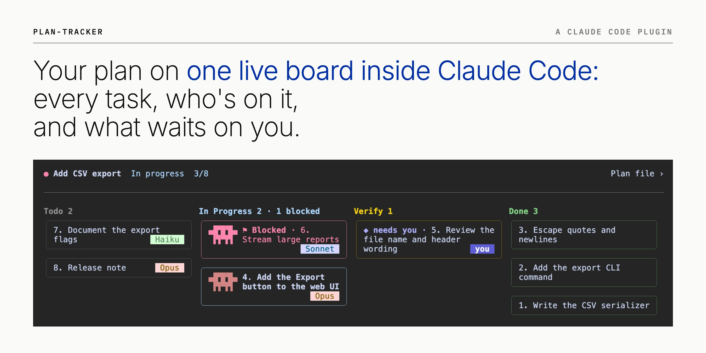

<sub>The board on the cover is a demo plan: adding CSV export to a report CLI, 3 of 8 tasks done.</sub>

<h3 align="center">
  <a href="#get-started">Get started</a> |
  <a href="#where-it-runs">Where it runs</a> |
  <a href="#how-it-works">How it works</a> |
  <a href="#try-it">Try it</a> |
  <a href="#what-you-get">What you get</a> |
  <a href="#compared">Compared</a> |
  <a href="#limits">Limits</a> |
  <a href="#reference">Reference</a>
</h3>

# plan-tracker

Claude Code mod that puts your plan on one live board: every task, who's on it, and what waits on you.

## Get started

Install plan-tracker and [plan-orchestrator](https://github.com/lijingwu2026/claude-code-plan-orchestrator), the separate plugin that writes your plan's tasks to `PROGRESS.md`:

```
/plugin marketplace add lijingwu2026/claude-code-plan-orchestrator
/plugin install plan-orchestrator@plan-orchestrator
/plugin marketplace add lijingwu2026/claude-code-plan-tracker
/plugin install plan-tracker@plan-tracker
```

| To | Do |
|---|---|
| See your plan | Approve a plan in plan mode. The band appears above your prompt, in every session of that project. |
| Open the board | Press the bar, or type `/plan-tracker`. |
| Pick a plan | `/plan-tracker` lists your open plans, newest first, with a search field. Typing also finds done and canceled plans. This needs a board command that lists several plans. A plain `PROGRESS.md` has one plan, so it opens its board. |
| Use your own `PROGRESS.md` | Copy the table under [Try it](#try-it). plan-orchestrator is not needed. |

## Where it runs

| Place | Status | Tested on | Screenshot |
|---|---|---|---|
| Terminal (macOS) | Tested | Claude Code 2.1.301 | [terminal](docs/platform-terminal.png) |
| Claude Desktop app (macOS) | Tested | Desktop 2.31226.1, which runs Claude Code 2.1.295 | [Desktop](docs/platform-desktop.png) |
| VS Code extension | Tested in Cursor | Claude Code extension 2.1.300; VS Code itself is not tested | [Cursor](docs/platform-vscode.png) |

## How it works

The route skill in plan-orchestrator writes your plan's tasks to `PROGRESS.md` and updates them as they run. plan-tracker reads that file and never writes it.


## Try it

Save this as `PROGRESS.md` in your project root. The band appears within a few seconds, the board shows a card in Done, In Progress and Verify, and task 3 says `◆ needs you`.

```markdown
# Add CSV export

| task | status | executor | check | evidence |
|---|---|---|---|---|
| 1. Write the serializer | Done | subagent · Sonnet | script | 12 tests pass |
| 2. Add the export command | In Progress | main session · Opus | script | |
| 3. Review the file name wording | Needs Verification | main session · Opus | you | draft ready |
```

Change a status in the file and the board follows.

## What you get

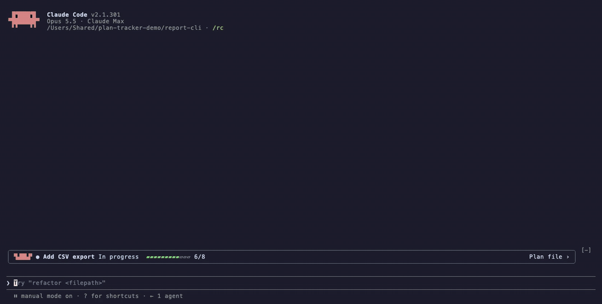

<sub>14 s. `/plan-tracker` opens the board, then the plan's `PROGRESS.md` changes: task 7 goes In Progress, then Done (a pop-up `✅ 7. Document the export flags · 1 left` and a chime); then task 4, the last open one, goes Done (a pop-up, a chime, and the band's bar turns to a rainbow until the next prompt). The board reads the file every 1.5 s, so no one has to tell you a task moved. [docs/demo.mp4](docs/demo.mp4) is the same with sound.</sub>

### Band

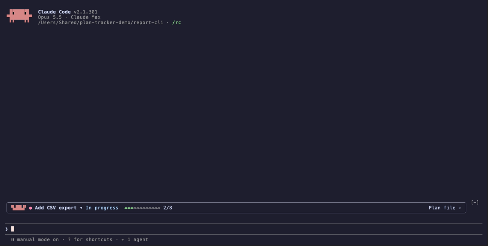

<sub>The board is closed; the band is the one line above the prompt, in every session of the project.</sub>

- Above your prompt: the state word (`In progress`, `Waiting for you`, `Idle` or `Done`), done out of total (`3/8`) and a bar. The plan reads `In progress` while Claude is working on it, even when no task is marked In Progress, and `Waiting for you` when the only tasks left wait on your check.
- **A task is done** → a pop-up `✅ <task> · N left` and, in the terminal, a chime.
- **You come back, or start a new session** → the band shows the file's state; the board has Claude's last recap.

<details>
<summary>Parts</summary>

<table>
<thead><tr><th width="480">Looks like</th><th>Part</th><th>Shows</th><th>Press</th></tr></thead>
<tbody>
<tr><td>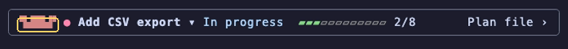</td><td><b>Mascot</b></td><td>Moves while a task is running (In Progress or Verifying); stands still otherwise.</td><td>Opens or closes the board.</td></tr>
<tr><td>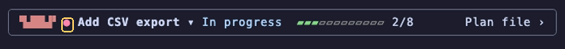</td><td><b>Dot</b></td><td>The colour of the most urgent open task: red Blocked, yellow waiting for a check, blue In Progress, grey Todo; green when every task is Done. Red here: task 6 is blocked.</td><td>Opens or closes the board.</td></tr>
<tr><td>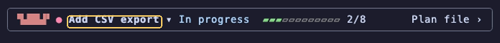</td><td><b>Plan name</b></td><td>The plan's name, cut with <code>…</code> when the band is short of room.</td><td>One plan: opens or closes the board. Several plans: opens the plan list.</td></tr>
<tr><td>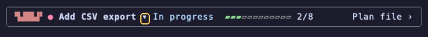</td><td><b><code>▾</code></b></td><td>Shown when there are several plans.</td><td>Opens the plan list under the band; pick a plan to show it.</td></tr>
<tr><td>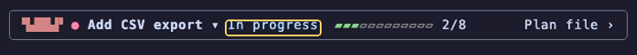</td><td><b>State word</b></td><td><code>In progress</code>, <code>Stalled since …</code>, <code>Waiting for you since …</code>, <code>Idle since …</code> or <code>Done at …</code> (see the board's plan states). Left out when the band is short of room.</td><td>Opens or closes the board.</td></tr>
<tr><td>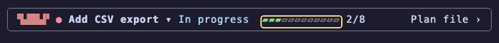</td><td><b>Bar</b></td><td>Done tasks over all tasks but the Canceled ones, filled in green; a rainbow once the last task goes Done.</td><td>Opens or closes the board.</td></tr>
<tr><td>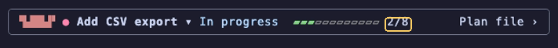</td><td><b>Count</b></td><td>The same as a number: <code>2/8</code>.</td><td>Opens or closes the board.</td></tr>
<tr><td>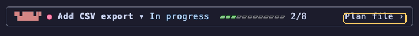</td><td><b><code>Plan file ›</code></b></td><td>Reads <code>‹ Board</code> while the plan file is open.</td><td>Opens the plan file in the board pane; <code>‹ Board</code> goes back.</td></tr>
</tbody>
</table>

</details>

<details>
<summary>States</summary>

<table>
<thead><tr><th width="480">Looks like</th><th>State</th><th>When</th></tr></thead>
<tbody>
<tr><td>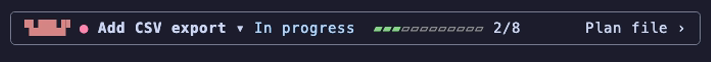</td><td><b>In progress</b></td><td>A task is running, or Claude is working on the plan now. Red dot: one task is blocked.</td></tr>
<tr><td>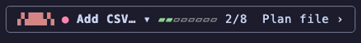</td><td><b>Board open</b></td><td>The board takes the right of the window, so the name is cut and the state word left out; the dot still carries the colour.</td></tr>
<tr><td>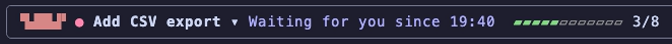</td><td><b>Waiting for you</b></td><td>Nothing is running and a task waits for your check, with you as its checker or its executor: <code>Waiting for you since 19:40</code>, in the <code>◆ needs you</code> colour.</td></tr>
<tr><td>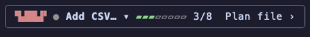</td><td><b>Idle</b></td><td>Nothing is running and nothing waits on you: grey dot, still mascot.</td></tr>
<tr><td>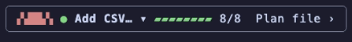</td><td><b>Done</b></td><td>Every task is Done: green dot, full bar.</td></tr>
<tr><td>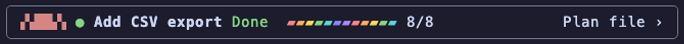</td><td><b>Last task done</b></td><td>Right after the last open task goes Done: a pop-up and a chime, and the bar is a moving rainbow until your next prompt.</td></tr>
<tr><td>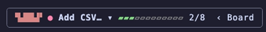</td><td><b>Plan file open</b></td><td><code>Plan file ›</code> becomes <code>‹ Board</code>.</td></tr>
</tbody>
</table>

</details>

### Board

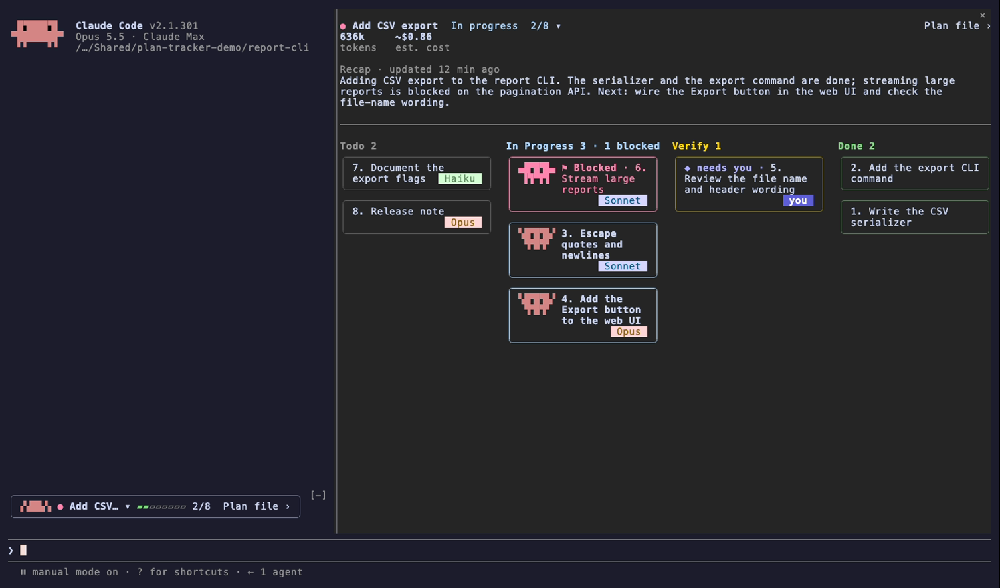

<sub>The board opens in a pane on the right; the band stays above the prompt. These board screens read the board from a command that lists two plans, so they show tokens, est. cost, the plan's times and stalled tasks; a plain `PROGRESS.md`, as in the video, draws the same board without those figures.</sub>

- **Claude adds a task** → a card for it appears.
- **A task is blocked** → its card sits red at the top of In Progress; open its page and the latest note says why.
- **You want to know who runs what** → each open card is tagged with who has it: `Opus`, `Sonnet`, `Haiku` or `you` (in Verify, who checks it). A Done task's page says who did it and who checked it.

<details>
<summary>Parts</summary>

<table>
<thead><tr><th width="480">Looks like</th><th>Part</th><th>Shows</th><th>Press</th></tr></thead>
<tbody>
<tr><td>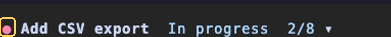</td><td><b>Dot</b></td><td>As on the band: the most urgent open task's colour.</td><td>&mdash;</td></tr>
<tr><td>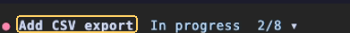</td><td><b>Plan name</b></td><td>The plan's name, in bold.</td><td>Several plans: opens or closes the plan menu.</td></tr>
<tr><td>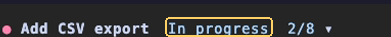</td><td><b>State word</b></td><td>The plan's state and its only time (see Plan states below).</td><td>&mdash;</td></tr>
<tr><td>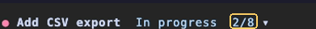</td><td><b>Count</b></td><td>Done tasks over all tasks but the Canceled ones.</td><td>&mdash;</td></tr>
<tr><td>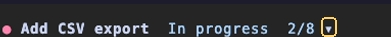</td><td><b><code>▾</code></b></td><td>Shown when there are several plans; <code>▴</code> while the plan menu is open.</td><td>Opens or closes the plan menu.</td></tr>
<tr><td>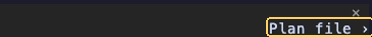</td><td><b><code>Plan file ›</code></b></td><td>The plan behind the board.</td><td>Opens the plan file page.</td></tr>
<tr><td>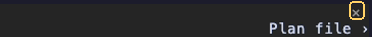</td><td><b><code>✕</code></b></td><td>Closes the pane.</td><td>Closes the board; the band stays.</td></tr>
<tr><td>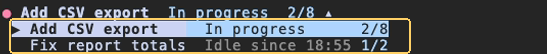</td><td><b>Plan menu</b></td><td>This project's plans with state and count; the one shown is highlighted and marked <code>▶</code>.</td><td>A plan: shows its board.</td></tr>
<tr><td>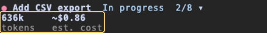</td><td><b>Figures</b></td><td>Tokens and est. cost of the whole plan, from the board command. A plain <code>PROGRESS.md</code> has none.</td><td>&mdash;</td></tr>
<tr><td>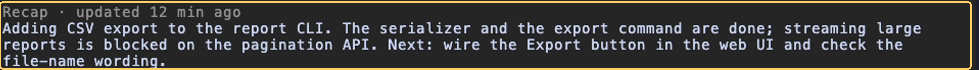</td><td><b>Recap</b></td><td>Claude's two or three sentences: what the plan is for, where it is, what is next or needed from you. <code>updated 12 min ago</code> when the board command gives its time.</td><td>&mdash;</td></tr>
<tr><td>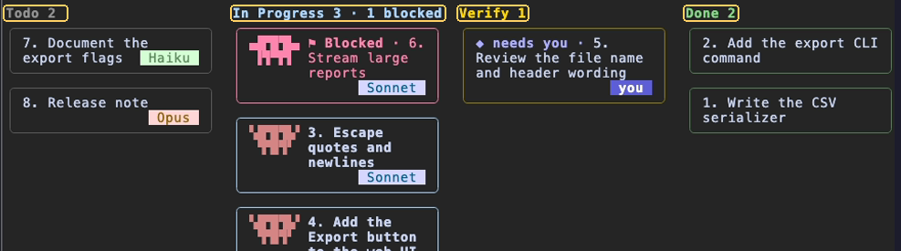</td><td><b>Lanes</b></td><td>Todo, In Progress, Verify and Done, each with its count; In Progress adds <code>· 1 blocked</code>. Each lane lists its latest-updated task first; Blocked comes first in In Progress.</td><td>&mdash;</td></tr>
<tr><td>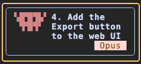</td><td><b>Card</b></td><td>One task. The border takes the task's colour (blue here: In Progress). A <code>progress</code> value draws a bar on the card, when the card is wide enough.</td><td>Opens its task page.</td></tr>
<tr><td>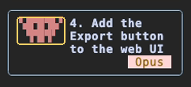</td><td><b>Card mascot</b></td><td>Moves while the task runs; frozen when it is blocked or stalled; none on Todo and Done cards.</td><td>Opens its task page.</td></tr>
<tr><td>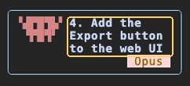</td><td><b>Task name</b></td><td>The whole name, wrapped; a marker before it when blocked (<code>⚑ Blocked ·</code>) or waiting for you (<code>◆ needs you ·</code>).</td><td>Opens its task page.</td></tr>
<tr><td>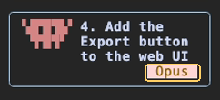</td><td><b>Tag</b></td><td>Who does the task or takes it next: <code>Opus</code>, <code>Sonnet</code>, <code>Haiku</code> or <code>you</code>; in Verify, who checks it; grey <code>stalled</code> when no session is working on it; none on Done, and none when the task's <code>route</code> names neither a model nor you.</td><td>Opens its task page.</td></tr>
<tr><td>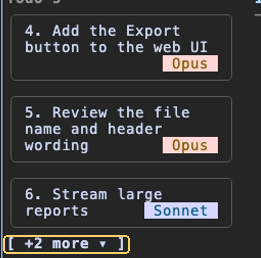</td><td><b><code>+N more ▾</code></b></td><td>A lane holds more cards than it shows.</td><td>Unfolds the lane; <code>Show less ▴</code> folds it again.</td></tr>
<tr><td>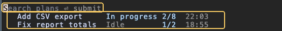</td><td><b>Plan list</b></td><td><code>/plan-tracker</code> lists every plan, latest first, under a <code>Search plans</code> field: name, state, count and when it last changed. Needs a board command that lists several plans; a plain <code>PROGRESS.md</code> opens its board directly.</td><td>Typing filters; Enter or a press opens the plan.</td></tr>
<tr><td>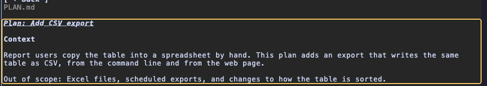</td><td><b>Plan file page</b></td><td>The plan file drawn as Markdown, under <code>‹ Back</code> and its file name. For a plain <code>PROGRESS.md</code> that is the file itself.</td><td><code>‹ Back</code> returns to the board.</td></tr>
</tbody>
</table>

</details>

<details>
<summary>States</summary>

**Plan states**

<table>
<thead><tr><th width="480">Looks like</th><th>State</th><th>When</th></tr></thead>
<tbody>
<tr><td>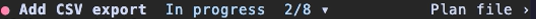</td><td><b>In progress</b></td><td>A task is In Progress or Verifying and not stalled, or Claude is working on the plan now: this session runs a turn or a background agent, and the plan is this session's (the one plan of a <code>PROGRESS.md</code>; with a board command, a plan sent with <code>in_session: true</code>). Agents a Workflow starts are not counted. No time.</td></tr>
<tr><td>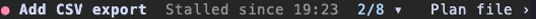</td><td><b>Stalled</b></td><td>Every running task is stalled and this session is not working on the plan: your board command marks a task with <code>stalled_since</code>, meaning no session is working on it. A plain <code>PROGRESS.md</code> has no session data and never shows this. <code>Stalled since 19:23</code>, the newest <code>stalled_since</code>.</td></tr>
<tr><td></td><td><b>Waiting for you</b></td><td>Nothing is running and a Needs Verification task has you as its checker or its executor: <code>Waiting for you since 19:40</code>, the later of <code>idle_since</code> and when this session last stopped working (plain without either), in the <code>◆ needs you</code> colour.</td></tr>
<tr><td>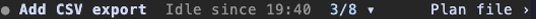</td><td><b>Idle</b></td><td>Nothing is running and nothing waits on you, including a plan nothing has started: <code>Idle since 19:40</code>, the later of <code>idle_since</code> and when this session last stopped working (plain <code>Idle</code> without either).</td></tr>
<tr><td>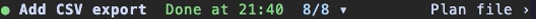</td><td><b>Done</b></td><td>Every task is Done or Canceled (one at least Done), or your board command sends <code>finished</code>: <code>Done at 21:40</code>, from <code>finished</code>, else <code>updated</code> (plain <code>Done</code> with neither), with a green dot.</td></tr>
</tbody>
</table>

**Card states**

<table>
<thead><tr><th width="301">Looks like</th><th>State</th><th>When</th></tr></thead>
<tbody>
<tr><td>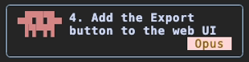</td><td><b>Running</b></td><td>In Progress: the mascot moves; the tag is the model doing it.</td></tr>
<tr><td>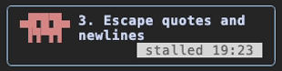</td><td><b>Stalled</b></td><td>In Progress, but no session is working on it: the mascot stands still and a grey <code>stalled 19:23</code> (<code>stalled Oct 11</code> from another day) replaces the tag; a card too narrow for the time shows the bare <code>stalled</code>.</td></tr>
<tr><td>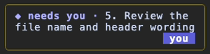</td><td><b>Waiting for you</b></td><td>You are its checker or its executor: <code>◆ needs you ·</code> before the name, tag <code>you</code>.</td></tr>
<tr><td>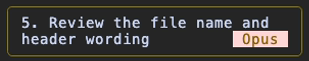</td><td><b>Waiting for a check</b></td><td>A model checks it: no marker; the tag is the checker's model. A script checks it: no tag.</td></tr>
<tr><td>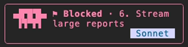</td><td><b>Blocked</b></td><td>Red, <code>⚑ Blocked ·</code> before the name, the mascot frozen; the tag is who runs it.</td></tr>
<tr><td>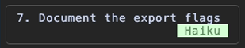</td><td><b>Todo</b></td><td>No mascot; the tag is who will do it.</td></tr>
<tr><td>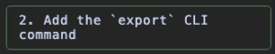</td><td><b>Done</b></td><td>No tag; its page says who did it.</td></tr>
</tbody>
</table>

**Narrow pane**

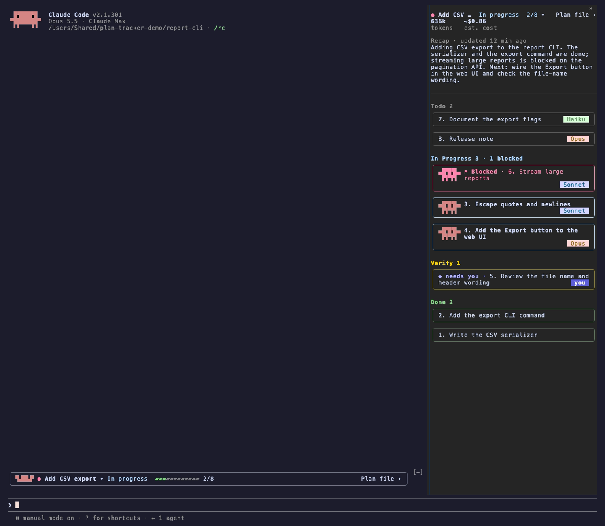

<sub>Below about 100 columns the lanes stack into one column and the recap wraps to the pane.</sub>

</details>

### Task page

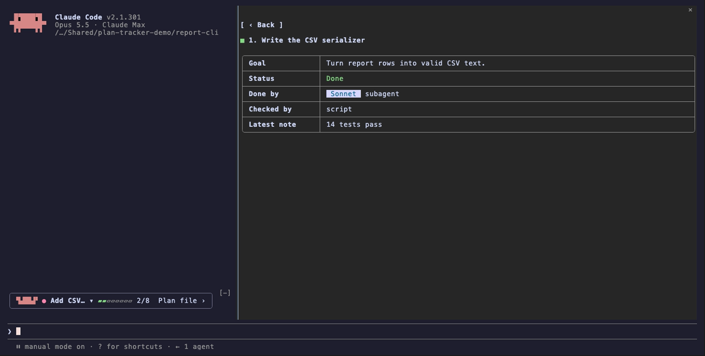

<sub>Pressing a card opens its page in the board pane. A row is left out when there is nothing to show.</sub>

- **A task needs your review** → its card says `◆ needs you`; open its page for the goal and the latest note.

<details>
<summary>Parts</summary>

<table>
<thead><tr><th width="480">Looks like</th><th>Part</th><th>Shows</th><th>Press</th></tr></thead>
<tbody>
<tr><td></td><td><b><code>‹ Back</code></b></td><td>&mdash;</td><td>Returns to the board.</td></tr>
<tr><td></td><td><b>Title</b></td><td>The task's whole name; the square takes the status colour.</td><td>&mdash;</td></tr>
<tr><td></td><td><b>Goal</b></td><td>One sentence on what the task is for.</td><td>&mdash;</td></tr>
<tr><td></td><td><b>Status</b></td><td><code>To do</code>, <code>In progress</code>, <code>Waiting for your check</code>, <code>Waiting for a check</code>, <code>Being checked</code>, <code>⚑ Blocked</code> or <code>Done</code>, in its colour; a stalled task, with no session working on it, adds <code>· stalled since …</code>.</td><td>&mdash;</td></tr>
<tr><td></td><td><b>Done by</b></td><td>Who runs it, with the model as a tag; <code>you</code> for your own tasks.</td><td>&mdash;</td></tr>
<tr><td></td><td><b>Checked by</b></td><td>Who checked it, once the task is Done.</td><td>&mdash;</td></tr>
<tr><td><i>Not in these shots</i></td><td><b>Progress</b></td><td>The <code>progress</code> bar.</td><td>&mdash;</td></tr>
<tr><td></td><td><b>Latest note</b></td><td>The newest note on the task. A file path in it is a link; a terminal without OSC 8 hyperlink support prints the address after the link.</td><td>A path opens the file.</td></tr>
<tr><td></td><td><b>Blocked because</b></td><td>Takes the Latest note's place on a blocked task.</td><td>&mdash;</td></tr>
<tr><td><i>Not in these shots</i></td><td><b>Time, tokens, est. cost</b></td><td>Above the table, when the board command supplies them for that task. None for a task you run yourself.</td><td>&mdash;</td></tr>
</tbody>
</table>

</details>

## Compared

Use plan-tracker alongside Claude Code's own views; each shows something different.

| Claude Code's | It shows | plan-tracker adds |
|---|---|---|
| Agent map (Desktop, VS Code) | This session's subagents, each with its status, time and tokens | The plan's tasks across sessions: who has each one and what waits on you |
| Background tasks (`/tasks`) | Shells and subagents running in this session, cleared when Claude Code exits | Which tasks are running, blocked or done, kept in a file after the session ends |

## Limits

- Read-only for your board: it never writes `PROGRESS.md`.
- Polls the file about every 1.5 s; it does not use file-system events.
- Shows the first table in the file with `task` and `status` columns, as one plan.
- Every open session on the same project shows the pop-up and plays the chime when a task goes Done.
- Tested on macOS only; see [Where it runs](#where-it-runs) for versions.
- In the VS Code extension, file paths in notes are plain text; they do not open when pressed.
- Claude Code mods are an early-access feature.

## Troubleshooting

- **No band.** Run `/plan-tracker`: the board says what is wrong with the file. It needs a table with `task` and `status` columns.
- **`/plan-tracker` is not found.** Run `claude plugin list`: `plan-tracker@plan-tracker` must be enabled. If you already have a `/plan-tracker` command, yours is kept; press the bar to open the board.
- **Nothing changed after install.** Restart Claude Code. `claude plugin update` ends with "Restart to apply changes".

## Reference

[docs/reference.md](docs/reference.md): lanes, the board file and its columns, settings, the board command's JSON, and what plan-orchestrator fills.

## License

MIT
